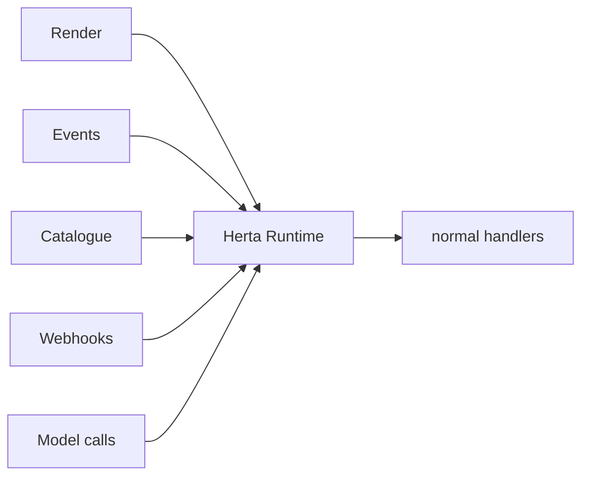
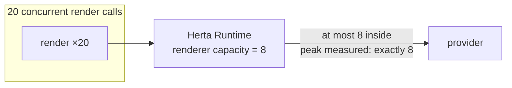
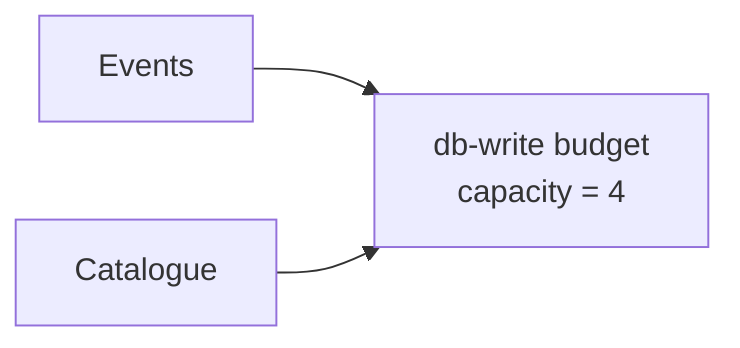
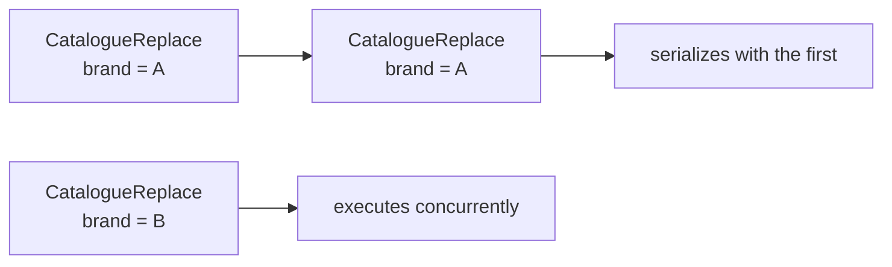
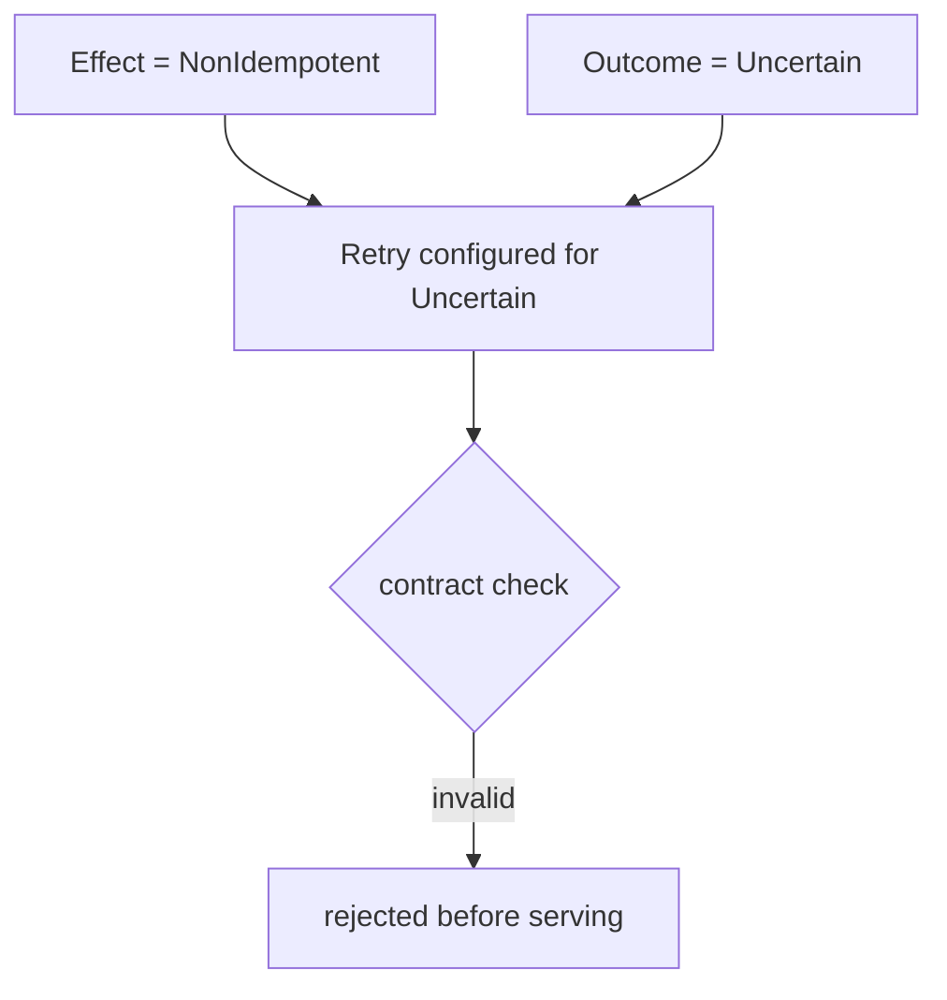
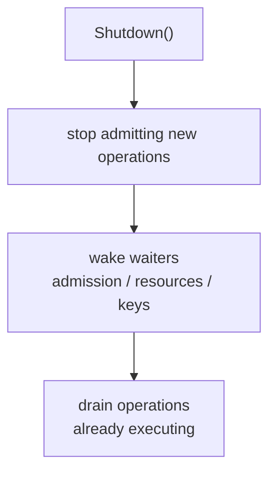

<div align="center">

<p align="center">
  
</p>

<p align="center">
  
  
</p>

**One execution model. Many heterogeneous operations.**

HertaSDK is an in-process execution contract runtime for Go. Operations stay
ordinary Go functions and declare what they consume, what side effects they
produce, and what failure means — the runtime validates those contracts and
arbitrates shared local capacity across otherwise-independent subsystems.


</div>

> **Status.** HertaSDK **1.0-next** is the v1.0 candidate: the execution
> contract rebuilt from first principles, with zero dependencies, the
> package renamed to `hertasdk`, and twelve v0.2 defects fixed. It is
> being hardened before it is locked as v1.0. The latest tagged release is
> v0.2.0.
>
> ```sh
> go get github.com/arahe-dev/hertasdk@main      # 1.0-next
> go get github.com/arahe-dev/hertasdk@v0.2.0    # last tagged release
> ```
>
> The execution contract is defined in [docs/contract.md](docs/contract.md):
> `Wait` / `Reject` admission, shared weighted resources, keyed
> serialization, `Effect` / `Outcome` failure semantics, bounded safe
> retries, cooperative timeouts, shutdown/drain, and atomic stats. **Queue
> is explicitly not part of the contract.** See [ROADMAP.md](ROADMAP.md) and
> [CHANGELOG.md](CHANGELOG.md).

---

## Contents

- [What is HertaSDK?](#what-is-hertasdk)
- [Why?](#why)
- [Core model](#core-model)
- [Resource arbitration](#resource-arbitration)
- [Keyed serialization](#keyed-serialization)
- [Failure semantics](#failure-semantics)
- [Lifecycle](#lifecycle)
- [What Herta is NOT](#what-herta-is-not)
- [Quickstart (real API)](#quickstart-real-api)
- [Current validation](#current-validation)
- [Roadmap](#roadmap)
- [Design principles](#design-principles)
- [Name / inspiration](#name--inspiration)
- [Docs](#docs)
- [Contributing / Security](#contributing--security)
- [License](#license)

---

## What is HertaSDK?

HertaSDK is a **local, in-process runtime** that owns execution policy — not
business logic. An operation is a typed wrapper around a normal handler; the
operation declares its execution contract and Herta enforces it:

<p align="center">
  
  
</p>

- **Operations remain normal Go functions.** Herta wraps them; it never owns
  what they compute, store, or return.
- **Herta owns execution policy.** Admission, shared resource budgets, keyed
  serialization, timeouts, retry safety, and shutdown belong to the runtime.
- **Contracts are declared up front.** Resources consumed, side-effect class,
  contention behavior, and failure meaning are part of construction — invalid
  combinations are rejected before serving, not discovered at 3am.
- **Arbitration is shared.** Independent subsystems (render, events, catalogue,
  webhooks, model calls) draw from the same named local budgets instead of
  each inventing its own semaphore, pool, and retry loop.

Start with [docs/concepts.md](docs/concepts.md) and
[docs/execution-model.md](docs/execution-model.md).

## Why?

Without a shared model, every subsystem invents slightly different execution
plumbing:

| Subsystem | Reinvented plumbing |
|---|---|
| Render | own semaphore / retry logic |
| DB writer | own pool / ordering logic |
| Webhook | own retry logic |
| Catalogue | own per-key locking |
| Model call | own quota handling |

Each one is subtly different, subtly wrong in a different way, and impossible
to reason about as a whole.

With Herta, shared policy and shared resources stay explicit:



Herta does **not** replace application-level business logic. It replaces the
five slightly-different semaphores, the four slightly-different retry loops,
and the three slightly-different shutdown paths with one contract the whole
process obeys.

Like nodes on a CAN bus, each worker runs asynchronously at its own pace —
different speeds, different shapes — but all obey the same arbitration and
error semantics:

<p align="center">
  
  
</p>

## Core model

| Primitive | Meaning |
|---|---|
| `Runtime` | Execution authority and lifecycle owner. Owns budgets, admission, shutdown. |
| `Operation[I, O]` | Typed wrapper around a normal handler. Carries a `Policy`. |
| `Resource` | A named finite local capacity (e.g. `renderer`, `db-write`), declared as a `ResourceSpec`. Weighted. |
| `Policy` | Resources, admission (`Wait`/`Reject`), timeout, retry, optional `SerializeKey func(I) string`. |
| `Effect` | Side-effect class: `Pure`, `Idempotent`, `NonIdempotent`. The zero value is `EffectUnknown` — omitting `Effect` is a construction error (`ErrEffectRequired`), never a silent claim of safety. |
| `Outcome` | Failure meaning: `Success`, `Transient`, `Permanent`, `Throttled`, `Uncertain`. |

Effect says **whether repeating is safe**. Outcome says **what happened**.
Retry decisions require both — see [Failure semantics](#failure-semantics)
and [docs/failure-semantics.md](docs/failure-semantics.md).

## Resource arbitration

This is the defining feature — and it is more than "Herta has a semaphore."

Different operations may consume the **same** resource. A renderer budget of 8
is shared by every render call regardless of caller; a `db-write` budget is
shared by events and catalogue writes alike.

<p align="center">
  
  
</p>

Concrete behavior, proven by `TestCapacityLimitHeldUnderLoad` (`renderer`
capacity = 8, 20 concurrent render calls, measured peak inside the
provider: **exactly 8**):



And across subsystems sharing one budget:



Each budget is a strict FIFO queue: a request is granted at once only if it
fits **and** nobody is waiting, so heavy requests never starve. A `Reject`
call that cannot be granted fails at once with `Throttled` and yields the
processor once, so a caller retrying in a tight loop cannot starve the
calls holding capacity.

Herta arbitrates **per process**. It does not coordinate resources globally
across processes — see [docs/resource-arbitration.md](docs/resource-arbitration.md).

## Keyed serialization

Some operations must serialize per key while staying concurrent across keys:



`SerializeKey` (a `func(I) string`; an empty key means no serialization)
gives same-key serial / different-key concurrent execution. Same-key waiters
hold **zero downstream resource capacity** while waiting — waiting work must
not hoard scarce resources. Under `Reject`, a call whose key is held fails
fast instead of waiting.

## Failure semantics

Retry decisions depend on **both** what happened and whether repeating is safe.
The important case is a contract the runtime rejects at construction:



Why: the external operation may already have executed, consumed quota, charged
money, or changed state. Retrying it speculatively is not a transport decision
— it is a business-safety decision, and the contract says it is unsafe.

Rules:

- Unclassified Go errors are treated **conservatively**: they do not trigger
  speculative retries. A nil `*Failure` returned by mistake reads as
  unclassified too, never as a crash.
- Unsafe retry combinations (e.g. retrying `Uncertain` on a `NonIdempotent`
  operation) fail construction-time validation.
- An unclassified error after the attempt's own deadline is `Uncertain`
  for every `Effect`; it is retried only where `Uncertain` retries are safe.
- `Transient` is the adapter's word that the attempt did not take effect.
  Herta trusts it, so tag it only where that is true.
- Caller cancellation is honored and never retried; per-attempt timeouts are
  cooperative contexts, not goroutine termination.

Full treatment in [docs/failure-semantics.md](docs/failure-semantics.md).

## Lifecycle



- `Shutdown` returns only once everything admitted has drained; it is
  idempotent and safe to call concurrently, and costs no goroutines.
- Timeouts are cooperative `context.Context` deadlines.
- Panics release runtime-owned resources, then re-panic — cleanup without
  swallowing the failure.
- Stats are atomic and read in a consistent order; lifecycle behavior is
  race-clean under the Go race detector.

## What Herta is NOT

Herta is not:

- a message broker
- a durable queue
- a workflow engine
- a service mesh
- an RPC framework
- an actor framework
- a distributed semaphore
- a daemon
- a scheduler
- a sidecar

Herta is **process-local by design.** It arbitrates capacity inside one
process and does not coordinate a global capacity across processes:

```text
capacity 8 × 1 process ≈ 8 local slots
capacity 8 × 5 processes ≈ 40 independent local slots
```

Herta does NOT coordinate a global capacity across those five processes.
Global quotas and provider limits are the application's deployment
responsibility — enforce them at the shared provider, not in Herta.

Queue admission is deliberately descoped until a real consumer proves it is
needed: today, `Wait` (block for capacity) plus the caller's own context
deadline bounds how long a call waits.

## Quickstart (real API)

Install:

```sh
go get github.com/arahe-dev/hertasdk@main
```

Runnable example in [`examples/quickstart`](examples/quickstart/main.go)
(`go run ./examples/quickstart`):

```go
rt, _ := hertasdk.NewRuntime(hertasdk.ResourceSpec{Name: "worker", Capacity: 4})

// Idempotent operation: safe to retry Transient failures, waits for capacity.
render, _ := hertasdk.NewOperation(rt, "render",
    func(ctx context.Context, job string) (string, error) {
        if job == "flaky" {
            return "", hertasdk.Fail(hertasdk.Transient, errors.New("upstream hiccup"))
        }
        return "rendered:" + job, nil
    },
    hertasdk.Policy[string]{
        Effect:    hertasdk.Idempotent,
        Resources: []hertasdk.Requirement{{Name: "worker", Units: 1}},
        Admission: hertasdk.Wait,
        Retry:     hertasdk.RetryPolicy{MaxAttempts: 3, On: map[hertasdk.Outcome]bool{hertasdk.Transient: true}},
    })

// Non-idempotent operation: fails fast when busy, retries nothing.
charge, _ := hertasdk.NewOperation(rt, "charge",
    func(ctx context.Context, customer string) (string, error) {
        return "charged:" + customer, nil
    },
    hertasdk.Policy[string]{
        Effect:    hertasdk.NonIdempotent,
        Resources: []hertasdk.Requirement{{Name: "worker", Units: 1}},
        Admission: hertasdk.Reject,
    })

out, err := render.Do(ctx, "job-42")
fmt.Println(out, err)
fmt.Println(rt.Stats())
```

The package name is `hertasdk`, the same as the last element of its import
path. The handler is ordinary; the policy is explicit; the runtime does the
arbitrating. Nothing more.

## Current validation

HertaSDK 1.0-next was rebuilt from first principles against a written
contract ([docs/contract.md](docs/contract.md)) and checked against v0.2.0,
which is kept frozen in [`lab/v02`](lab/v02) as the reference. The
evidence lives in the [`lab/`](lab) module, which does not ship with the
package. The full report is [lab/results/r2/REPORT.md](lab/results/r2/REPORT.md).

**Correctness**

- v0.2.0's own test suite passes against `hertasdk`
- 75 tests, **100% statement coverage**, race-clean under the Go race detector
- 100,000-scenario differential run against a reference model of the contract
- Invariants under load (30 rounds) and chaos (100 rounds: cancellations,
  panics, racing shutdowns) with zero violations
- **100% mutation score**: 394 of 394 mutants killed
- The real consumer's test suite (render, events, catalogue, handoff) runs
  identically with `hertasdk` in place of v0.2.0
- Twelve v0.2 defects fixed, each pinned by a test; see [CHANGELOG.md](CHANGELOG.md)

**Performance against v0.2.0** (quiet machine, methodology in
[lab/results/r2](lab/results/r2/REPORT.md))

| | v0.2.0 | 1.0-next |
|---|---:|---:|
| uncontended `Do` | 893 ns · 10 allocs | **59 ns · 0 allocs** |
| `Do` with a per-attempt timeout | 1,465 ns · 14 allocs | **350 ns · 4 allocs** |
| keyed `Do` | 1,107 ns · 13 allocs | **103 ns · 0 allocs** |
| goroutines per call | 1 | **0** |
| memory per waiting call | 848 B + 7.7 KB stack | **157 B** |
| 1M unique keys: calls/s · peak heap | 0.71 M · 41.5 MB | **3.03 M · 6.0 MB** |
| mixed-load throughput · p99 latency | 243k/s · 889 µs | **417k/s · 346 µs** |

20 concurrent operations against capacity 8 still peak at exactly 8. The
runtime has no dependencies beyond the Go standard library.

## Roadmap

- [x] Go V0 implemented
- [x] Race-clean proof suite
- [x] Render workload validation
- [x] Events workload validation
- [x] CatalogueReplace third-consumer validation
- [x] Stable public Go extraction
- [x] Runnable quickstart
- [x] Baseline benchmarks
- [x] v0.2.0
- [x] First-principles reconstruction against a written contract (1.0-next)
- [x] Comparison lab: differential, chaos, mutation, DoE and industrial suites
- [x] Zero dependencies; package renamed `hertasdk`
- [ ] Harden 1.0-next and lock it as **v1.0**
- [ ] Additional real-world consumers
- [ ] Improve benchmark corpus when evidence warrants
- [ ] Evaluate Rust/Tower prototype
- [ ] Evaluate language-neutral spec only after multi-language evidence

Explicit non-goals: Queue without consumer evidence, distributed Herta,
durable workflow execution, transport ownership. No dates are promised.
Details in [ROADMAP.md](ROADMAP.md).

## Design principles

1. Business logic stays ordinary.
2. Shared constraints are explicit.
3. Retry safety is semantic, not guessed.
4. Waiting work should not hoard scarce resources.
5. Shutdown behavior is part of the execution contract.
6. Herta remains local until evidence proves a distributed layer is necessary.

## Name / inspiration

HertaSDK is named after Herta from Honkai: Star Rail — "many heterogeneous
clones sharing one environment" inspired the metaphor — and CAN-style resource
coordination influenced the architecture. Neither implies technical
compatibility or affiliation.

> **Disclaimer.** HertaSDK is an independent open-source project and is not
> affiliated with or endorsed by HoYoverse.

## Docs

- [docs/contract.md](docs/contract.md) — the normative execution contract (admission, retry, shutdown, stats, deltas from v0.2)
- [docs/concepts.md](docs/concepts.md) — Runtime, Operation, Resource, Policy, Effect, Outcome
- [docs/execution-model.md](docs/execution-model.md) — lifecycle, admission, ordering, rollback, timeout, shutdown
- [docs/failure-semantics.md](docs/failure-semantics.md) — classification, retry safety, Uncertain, cancellation
- [docs/resource-arbitration.md](docs/resource-arbitration.md) — shared budgets, weighting, per-process scope
- [docs/architecture.md](docs/architecture.md) — runtime boundary, integration shape, what Herta is not
- [lab/](lab) — the comparison lab and its results ([lab/results/REPORT.md](lab/results/REPORT.md))

## Contributing / Security

- [CONTRIBUTING.md](CONTRIBUTING.md)
- [CODE_OF_CONDUCT.md](CODE_OF_CONDUCT.md)
- [SECURITY.md](SECURITY.md)

## License

[Apache-2.0](LICENSE) — see [LICENSE](LICENSE).
