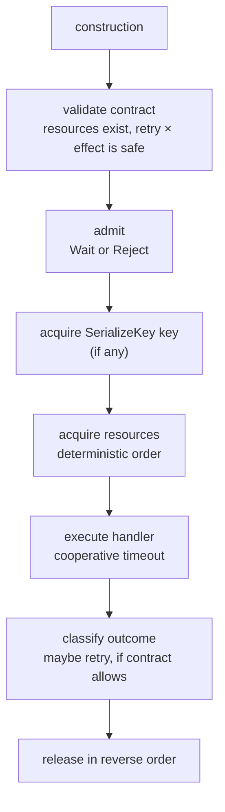

# Execution model

How one operation moves through the Herta runtime, in order.

## Operation lifecycle

Construction-time validation means an unsafe contract fails before serving —
not during a production incident.

## Admission

Each operation declares `Wait` or `Reject`:

- **Wait**: queue until capacity frees. Each budget is a strict FIFO queue:
  waiters are granted from the head for as long as each one fits, so a
  heavy request at the head holds lighter ones behind it rather than
  starving.
- **Reject**: fail immediately with `Fail(Throttled, ErrOverloaded)` when
  the claim cannot be granted now — the units are taken, someone is already
  queued, or the call's key is held. The refusal yields the processor once,
  so a caller that retries in a tight loop cannot starve the calls holding
  capacity. The caller decides what to do — back off, degrade, or drop.

Shutdown wakes all admission waiters: a caller whose own context ended gets
its `ctx.Err()`; the rest get `ErrRuntimeStopping`.

## Ordering: SerializeKey before resources

When an operation declares both a key and resources, the runtime acquires the
key **first**:

1. Wait for (or acquire) the key.
2. Only then acquire resource budgets.
3. Execute.

This ordering is load-bearing: a same-key waiter must not hold scarce
downstream capacity while blocked behind another operation holding the same
key. Catalog replacements for brand A serialize while brand B proceeds
concurrently — and neither hoards the `db-write` budget while waiting.

## Deterministic multi-resource acquisition

An operation claiming multiple resources acquires them in a fixed global order
(sorting by resource name). This eliminates acquisition-order deadlocks between
heterogeneous operations that share overlapping budgets.

While it waits for a later resource, an operation holds the earlier ones it
has already acquired: deadlock-free by ordering, not capacity-free. (Key
waiters, by contrast, hold nothing.)

## Rollback

If acquisition of the second (or later) resource fails — timeout, cancellation,
or shutdown — already-acquired resources are released before the operation
fails. Partial acquisition never leaks, and never holds one budget while
abandoning another.

Partial-acquire rollback is covered by `TestPartialAcquireRollsBack`, and by
the differential and chaos suites in [`lab/`](../lab).

## Cooperative timeout

Timeouts are per-attempt `context.Context` deadlines passed to the handler:

- The runtime cancels the context; it does not kill the goroutine. Each
  attempt gets a fresh deadline, and it is cancelled on every exit path,
  including a panic.
- Handlers that respect `ctx.Done()` stop promptly; handlers that ignore it
  run to completion, and a result they return without an error is returned
  to the caller, late.
- An unclassified error after the attempt's own deadline classifies as
  `Uncertain` for every `Effect`: the attempt may have taken effect. It is
  retried only if `RetryPolicy.On[Uncertain]` is set, which construction
  allows only for `Pure` and `Idempotent` operations. An adapter that knows
  better can tag the error itself (`Fail(Transient, err)`).
- When the caller's own deadline or cancellation ends an attempt, the call
  is over: the error is `Permanent` and never retried.

Go has no safe goroutine termination. Herta does not pretend otherwise.

## Shutdown

`Shutdown()` performs three steps, in order:

1. **Stop admitting** new operations.
2. **Wake** operations waiting for admission, resources, or keys.
3. **Drain** operations already executing, then return `nil`. If the
   caller's context ends first, `Shutdown` returns `ctx.Err()` and the drain
   continues.

`Shutdown` is idempotent and safe to call concurrently, and it starts no
goroutines. When it returns `nil`, `Stats().Finished == Stats().Admitted`.

Shutdown is part of the execution contract — callers can rely on it instead of
inventing their own drain logic per subsystem.
